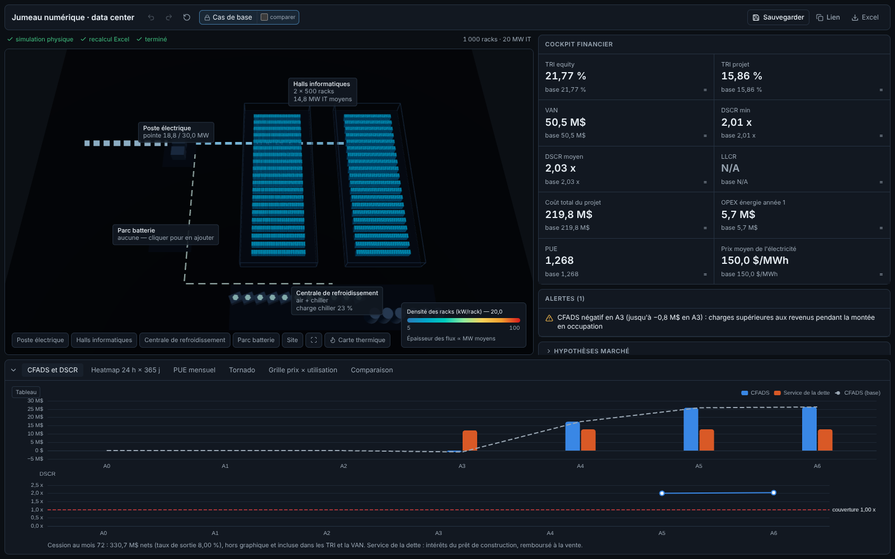

# Jumeau numérique de data center ↔ modèle financier Excel

Application web qui relie la **simulation physique d'un data center** (SustainDC, HPE) à un **modèle financier Excel** (A.CRE *Data Center Development Model* v1.7). Quand on modifie l'infrastructure ou les hypothèses dans le jumeau (taille, densité, refroidissement, site, batterie, prix de l'électricité, marché), trois choses s'enchaînent :

1. la simulation physique d'une année est relancée (pas de 15 min) ;
2. le classeur est recalculé ;
3. les KPI financiers se mettent à jour dans l'interface : d'abord un aperçu provisoire immédiat, puis les valeurs confirmées.



## Lancement en une commande

Prérequis : Python 3.11 (via [uv](https://docs.astral.sh/uv/) ou `python3.11`), Node 20+, LibreOffice (headless, avec le module Python `uno`) **ou** Excel + xlwings (Windows / macOS), git.

```bash
cp /chemin/vers/Data-Center-Development-Model-v1.7.xlsm model/   # le classeur n'est pas versionné
make dev                                                          # API :8000 + interface http://localhost:5173
```

`make dev` fait tout au premier lancement :

- crée `.venv` et installe `requirements-twin.txt` ;
- clone SustainDC dans `vendor/sustaindc`, épinglé au commit `a92b475` ;
- installe le front (`npm ci`) ;
- démarre l'API et l'interface. Ctrl+C arrête les deux.

Au démarrage, l'API calcule le cas de base (≈ 3 s), puis précalcule en tâche de fond le surrogate qui sert à l'aperçu (≈ 30 s).

> **Site de base.** Le classeur décrit un projet au Panama. La météo du Panama vient d'Open-Meteo ou de NASA POWER. Si ces domaines ne sont pas joignables, il y a trois solutions :
>
> - `TWIN_BASE_WEATHER_FILE=/chemin/tocumen.epw make dev` : fournir un EPW ;
> - `TWIN_BASE_SITE=us_ny_jfk make dev` : prendre un site US fourni avec SustainDC ;
> - téléverser l'EPW depuis l'inspecteur « Site » de l'interface.
>
> Aucune météo n'est inventée.

## Autres commandes

| Commande | Rôle |
|---|---|
| `make test` | 59 tests Python : parité avec SustainDC, moteur, non-régression du classeur, API |
| `make e2e` | test dans un vrai navigateur (Playwright) + captures dans `docs/screenshots/`. Chromium : `npx playwright install chromium`, ou `PLAYWRIGHT_CHROMIUM=/chemin/chrome` |
| `make bench` | temps d'une simulation annuelle |
| `make bridge` | reconstruit la copie pont du classeur (`build/twin_model.xlsm`) |
| `make api` / `make web` | API seule / interface seule |

## Architecture

```
twin/     moteur physique : run_year(params) -> TwinResults
          port vectorisé des équations SustainDC (parité ≤ 1e-9), sources de données publiques,
          tarifs, batterie, CAPEX paramétrique (twin/config/defaults.yaml), cache, journal
bridge/   pont Excel : copie du classeur avec Inputs_Twin (tw_*) et Outputs (out_*),
          moteurs xlwings / LibreOffice, solveur d'equity, export
api/      FastAPI : simulation en tâche de fond + SSE, aperçu (surrogate), scénarios,
          comparaison, sensibilités, export
web/      React + Vite + TypeScript, React Three Fiber, Zustand, TanStack Query, Tailwind/Radix, ECharts
vendor/   SustainDC, jamais modifié (écarts documentés dans docs/vendor_patches.md)
```

| Document | Contenu |
|---|---|
| [docs/mapping.md](docs/mapping.md) | phase 0 : lecture du classeur et de SustainDC, mapping paramètre → variable → cellule |
| [docs/phase1.md](docs/phase1.md) | moteur, temps de calcul, résultats |
| [docs/vendor_patches.md](docs/vendor_patches.md) | écarts au code SustainDC, approximations |
| [docs/phase2.md](docs/phase2.md) | pont Excel, non-régression, sensibilité du classeur |
| [docs/phase3.md](docs/phase3.md) | API, surrogate, sensibilités |
| [docs/phase4.md](docs/phase4.md) | interface |
| [docs/phase5.md](docs/phase5.md) | vérification |
| [docs/revue-financiere.md](docs/revue-financiere.md) | revue du cas de base : PUE, dette, montée en occupation, cession, carte thermique |
| [docs/sustaindc-README.md](docs/sustaindc-README.md) | README d'origine de SustainDC (ce dépôt est un fork de HewlettPackard/dc-rl) |

## Configuration

| Variable | Rôle |
|---|---|
| `TWIN_WORKBOOK` | classeur source (défaut `model/Data-Center-Development-Model-v1.7.xlsm`) |
| `TWIN_EXCEL_ENGINE` | `auto` (xlwings puis LibreOffice), `xlwings` ou `libreoffice` |
| `TWIN_BASE_SITE`, `TWIN_BASE_WEATHER_FILE` | site et météo du cas de base |
| `TWIN_DEFAULTS` | autre fichier de valeurs par défaut (coûts unitaires, rendements…) |
| `TWIN_STORE_DIR`, `TWIN_SCENARIO_LOG`, `TWIN_EXPORT_DIR` | scénarios et résultats, journal JSONL des simulations, exports Excel |
| `TWIN_LO_PYTHON`, `TWIN_SOFFICE` | Python avec `uno` et binaire LibreOffice, s'ils ne sont pas trouvés automatiquement |

## Données et licences

- **SustainDC** : licence MIT, © Hewlett Packard Enterprise.
- **Modèle financier** : A.CRE, *Adventures in CRE*. Sa licence impose de conserver l'onglet `Version`, et le pont le conserve. Le classeur n'est pas versionné, car il contient des données de projet et le dépôt est public.
- **Données publiques** : Open-Meteo (CC BY 4.0), NASA POWER, Our World in Data `energy-data` (CC BY 4.0). Chaque donnée affichée porte sa provenance et peut être remplacée à la main.
