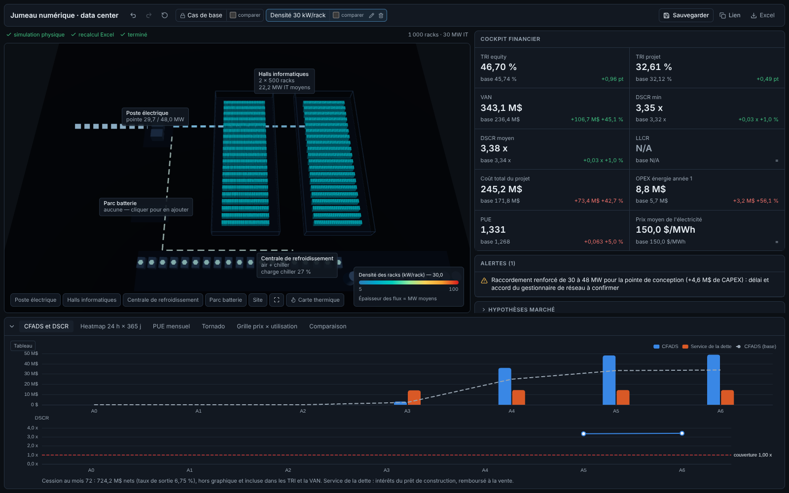
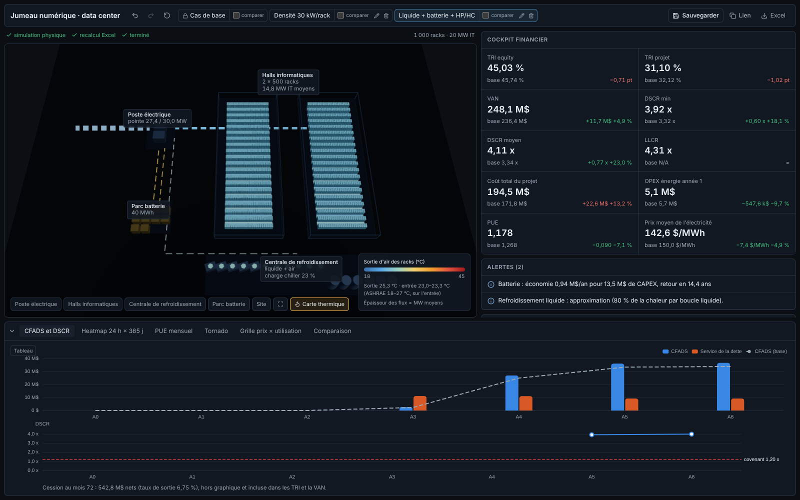
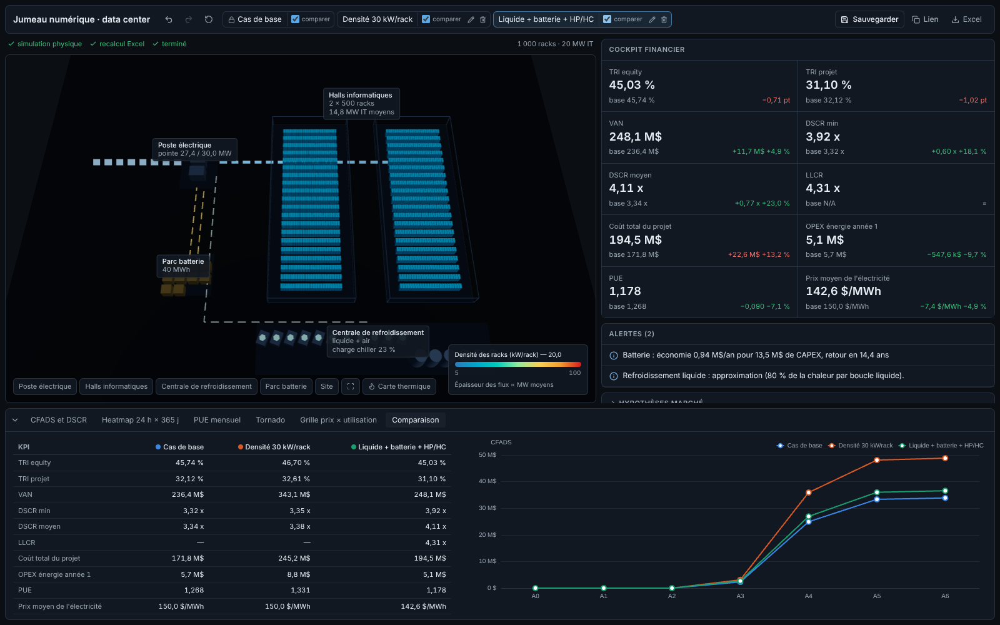

# Phase 5 — Vérification

Tout ce qui suit a été exécuté sur un **clone neuf** du dépôt (classeur copié dans `model/`), avec LibreOffice headless comme moteur de calcul du classeur.

## Lancement en une commande

```bash
make dev    # crée .venv, clone SustainDC (a92b475), npm ci, démarre l'API (:8000) et l'interface (:5173)
```

Vérifié sur le clone neuf : `make setup web-install` sans erreur. Avec `make dev`, `/health` renvoie `base_ready: true`, l'interface répond 200 et le proxy `/api/scenario/base` renvoie le cas de base.

## Tests automatisés

| Commande | Tests | Résultat |
|---|---|---|
| `make test` | 58 tests Python | ✔ 58 passés (≈ 105 s) |
| `make e2e` | parcours navigateur, 10 contrôles | ✔ tous passent |

### Moteur (`tests/test_engine.py`, `tests/test_vendor_parity.py`)

- **Bilan énergétique cohérent**, sur 8 configurations :
  - air, trace de charge, batterie et tarif HP/HC, batterie carbone, liquide, free cooling à Seattle, Phoenix COP 5, SustainDC brut ;
  - total = IT + refroidissement + pertes, à 1e-12 ;
  - refroidissement = compresseur + ventilateur de tour + CRAC + pompes + liquide ;
  - réseau = total + charge − décharge de la batterie ;
  - les sommes mensuelles et horaires retombent sur les totaux annuels.
- **PUE ≥ 1** : annuel et mensuel, sur les 8 configurations.
- **Monotonie** : plus de halls, de rangées, de racks par rangée ou de kW/rack donne plus de capacité IT, plus de MWh IT, plus de MWh totaux et plus de CAPEX.
- **Parité avec SustainDC** : l'environnement Gymnasium `dc_gymenv` d'origine et le port vectorisé concordent à ≤ 1e-9, pour les consignes 15, 18 et 21,6 °C.
- **Autres contrôles** :
  - capacité IT toujours dérivée de la géométrie ;
  - batterie dans ses limites ;
  - CAPEX de base = coûts durs du classeur ;
  - cache et journal ;
  - temps < 3 s ;
  - remplacements manuels prioritaires ;
  - aucune météo inventée si la source est injoignable.

### Pont Excel (`tests/test_bridge.py`)

- **Non-régression** : avec les paramètres du cas de base, **chacune des plus de 25 000 cellules numériques** des 4 feuilles du classeur original est reproduite à 1e-6 près (écart max observé : 2,4e-8). Les sorties ajoutées (VAN, OPEX énergie an 1, séries annuelles) sont recalculées indépendamment en Python et concordent aussi.
- **Cohérence** : VAN au taux du TRI = 0 (projet et equity).
- **Règles d'écriture** : seules les plages `tw_*` de la feuille `Inputs_Twin` sont acceptées, jamais une formule. La copie conserve le VBA et les boutons, et ses cellules recâblées pointent vers `tw_*`.

### Bout en bout

**Prix de l'électricité +10 % → OPEX énergie +10 % à l'arrondi près et TRI en baisse.** C'est vérifié à trois niveaux :

| Niveau | Test | Résultat |
|---|---|---|
| Moteur | `test_price_plus_ten_percent_gives_cost_plus_ten_percent` | coût d'énergie × 1,10 à 1e-12 |
| Classeur | `test_price_plus_ten_percent_end_to_end` (bridge) | OPEX énergie an 1 × 1,10 à 1e-9 ; TRI projet et equity en baisse |
| API | `test_price_plus_ten_percent_end_to_end` (api) | écart KPI OPEX +10 % ; TRI projet et equity défavorables |
| Interface | `make e2e` | saisie du prix +10 % dans l'inspecteur → « OPEX énergie année 1 : 6,2 M$, base 5,7 M$, +565 k$ **+10,0 %** » ; TRI equity −3,11 pt ; TRI projet −2,30 pt |

### Parcours navigateur (`web/e2e/e2e.mjs`)

```
✔ cas de base : OPEX énergie sans écart
✔ prix +10 % → OPEX énergie +10,0 %
✔ prix +10 % → TRI equity en baisse
✔ prix +10 % → TRI projet en baisse
✔ 30 kW/rack → alerte de dépassement de la capacité réseau
✔ clic sur l'alerte → inspecteur du poste électrique
✔ refinancement → DSCR min calculé
✔ comparaison : tableau des KPI affiché
✔ aucune erreur JavaScript
```

## Captures (Playwright, Chromium headless)

Site de base New York JFK, en attendant l'accès à la météo du Panama (voir README).

| Scénario | Capture |
|---|---|
| 1. Cas de base (2 halls × 20 rangées × 25 racks × 20 kW = 20 MW, air + chiller, tarif plat du classeur) |  |
| 2. Densité 30 kW/rack : 30 MW IT, pointe 46 MW > raccordement de 30 MW → alerte critique, poste en rouge |  |
| 3. Refroidissement liquide + batterie 10 MW / 40 MWh + tarif HP/HC (220 $/MWh de 17 h à 21 h les jours ouvrés, 90 $/MWh sinon) + refinancement ; carte thermique activée, DSCR et covenant |  |
| Comparaison des 3 scénarios (tableau des KPI + CFADS superposés) |  |

| KPI | Cas de base | Densité 30 kW | Liquide + batterie + HP/HC (même prix moyen) |
|---|---|---|---|
| TRI equity (avant impôt) | 45,74 % | 46,70 % | 45,03 % |
| TRI projet (avant impôt) | 32,12 % | 32,61 % | 31,10 % |
| VAN (8 %) | 236,4 M$ | 343,1 M$ | 248,1 M$ |
| DSCR min / moyen (années stabilisées) | 3,32x / 3,34x | 3,35x / 3,38x | 3,92x / 4,11x |
| LLCR | N/A | N/A | 4,31x |
| Coût total du projet | 171,8 M$ | 245,2 M$ (raccordement renforcé à 48 MW) | 194,5 M$ |
| OPEX énergie an 1 | 5,7 M$ | 8,8 M$ | 5,1 M$ |
| PUE (simulé, utilisé par le classeur) | 1,268 | 1,331 | 1,178 |
| Prix moyen de l'électricité | 150,0 $/MWh | 150,0 $/MWh | 142,6 $/MWh |

Hypothèses : voir [revue-financiere.md](revue-financiere.md).

- **Charge et pertes.** Les serveurs tirent 74 % de la puissance contractuelle (40 % de CPU), et 5 % de la puissance IT de conception part en pertes fixes.
- **Raccordement.** Il est dimensionné sur la pointe de conception.
- **Taxe foncière.** Elle est proportionnelle aux coûts durs.
- **DSCR.** Il est mesuré à partir de la première année stabilisée.
- **Scénario 3.** Son tarif HP/HC a le même prix moyen que le tarif plat : 135 $/MWh, et 260 $/MWh de 17 h à 21 h les jours ouvrés. À prix égal, refroidissement liquide et batterie (retour en 14,4 ans) **ne relèvent pas** le TRI : leur CAPEX dépasse l'économie d'énergie.
- **Niveau des TRI.** Ils sont élevés à cause du loyer tout compris (285 $/kW/mois) et du taux de sortie (6,75 %) du classeur. Ce sont les hypothèses à valider en priorité.

## Ce qui n'a pas pu être vérifié ici

- **Moteur xlwings (Excel)** : écrit et sélectionnable (`TWIN_EXCEL_ENGINE=xlwings`), mais Excel n'est pas disponible sous Linux. La non-régression devra être relancée chez toi avec `TWIN_EXCEL_ENGINE=xlwings make test`.
- **Site du Panama avec sa météo réelle** : Open-Meteo, NASA POWER, OneBuilding, NOAA et EnergyPlus sont refusés par la politique réseau de cette session. Le chemin a été testé avec un EPW fourni à la main.
